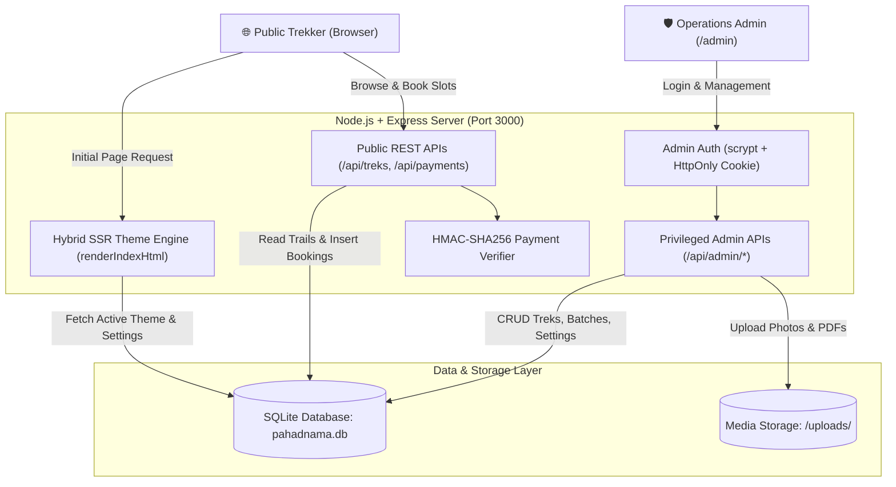

# 🏔️ Pahadnama Trails — Sahyadri Adventure Treks & Operations Platform

[](https://nodejs.org/)
[](https://expressjs.com/)
[](https://sqlite.org/)
[](https://razorpay.com/)
[](#)

> *"Safar Jahan Manzil Se Zyada Khoobsurat Hai"*  
> An authentic, end-to-end booking and trail operations platform for Sahyadri weekend expeditions in Maharashtra.

---

## 📌 1. Project Overview

**Pahadnama Trails** solves the operational friction of Maharashtra's commercial trekking ecosystem. Most adventure groups manage weekend batches across fragmented WhatsApp chats, manual UPI transfers, and manual spreadsheets. Pahadnama Trails replaces this with:

* **Real-time slot availability** across upcoming Saturday and Sunday batches.
* **Instant digital booking vouchers** with unique reference codes (`PAHAD-XXXX`).
* **Cryptographically verified payment gateways** (Razorpay Standard Checkout + direct WhatsApp fallback).
* **An executive administrative CMS** equipped with an Instagram/Meta Accounts Center security model.

---

## 🏗️ 2. System Architecture



---

## ✨ 3. Key Features

### 🌟 Public Trekker Experience
* **Curated Trail Showcase:** Filter iconic Maharashtra trails by *All Maharashtra Trails*, *Beginner Friendly*, *Moderate Forts*, and *Summit & Thrill* (Harishchandragad, Rajgad, Kalsubai, Devkund, etc.).
* **Detailed Route Statistics:** Peak elevation (ft), trail distance (km), expedition duration, inclusions/exclusions, hour-by-hour itinerary, and downloadable PDF guide.
* **Interactive Batch Calendar:** Dynamic Saturday & Sunday batch picker with live availability status (`AVAILABLE`, `FILLING FAST`, `FULL`).
* **Instant Digital Booking Pass:** Auto-generated printable booking voucher with verified payment badge, QR reference code, and 1-click WhatsApp share button.

### 💳 Dual-Mode Payment Engine
* **Razorpay Online Checkout:** Seamless checkout popup accepting UPI, Credit/Debit Cards, NetBanking, and Wallets.
* **HMAC-SHA256 Digital Verification:** Payment signatures are recalculated server-side using the secret key before confirming orders and decrementing seats.
* **Direct WhatsApp UPI Fallback:** Instant manual UPI QR transfer fallback for custom groups or when online gateways are offline.

### 🛡️ Executive Operations Console (`/admin`)
* **Live Operations Dashboard:** Real-time metrics tracking active trails, confirmed bookings, revenue, and moderated reviews.
* **Trail & Slot Inventory CRUD:** Full management of routes, custom pricing, cover photos, brochure PDFs, and weekend seats.
* **Hero Slideshow Customizer:** Multi-photo background loop with live opacity adjustment slider (0–100%).
* **Theme Engine:** 4 curated design presets (*Sahyadri Sanchara*, *Indiahikes Alpine*, *Rainforest Emerald*, and *Zostel Nomad*) rendered via Server-Side theme injection (zero FOUC).
* **Meta/Instagram-Style Security Center:**
  * Active admin handle with verified badge (`@the.life.passenger`).
  * Real-time 4-segment password strength meter (Weak / Fair / Good / Strong).
  * Strict two-factor validation: Changing username or password strictly requires current password verification.
  * Constant-time verification (`crypto.timingSafeEqual`) and memory-hard `scrypt` hashing.

---

## 🛠️ 4. Technology Stack

| Layer | Technologies | Description |
|---|---|---|
| **Frontend** | HTML5, CSS3, Vanilla ES6+ JavaScript | Modern semantic markup, CSS custom properties, and zero framework bloat. |
| **Backend** | Node.js (v20+ / v22+), Express.js | Asynchronous RESTful API engine with static asset serving and Multer upload middleware. |
| **Database** | Embedded SQLite (`node:sqlite`) | Synchronous `DatabaseSync` engine providing zero-latency reads and atomic transactions. |
| **Security** | Node.js `crypto` (`scrypt`, `timingSafeEqual`), HttpOnly Cookies | Memory-hard password key derivation, constant-time hash comparison, and XSS-immune sessions. |
| **Payments** | Razorpay SDK & Webhook Verification | Standard Checkout integration with HMAC-SHA256 cryptographic signature validation. |

---

## 🚀 5. Local Setup & Quick Start

### Prerequisites
* [Node.js](https://nodejs.org/) (v20.0.0 or higher recommended)
* [Git](https://git-scm.com/)

### Installation Steps

1. **Clone the repository:**
   ```bash
   git clone https://github.com/the-life-passenger/pahadnama-trails.git
   cd pahadnama-trails
   ```

2. **Install dependencies:**
   ```bash
   npm install
   ```

3. **Start the application:**
   ```bash
   npm start
   ```
   *(Or on Windows, double-click `START-WEBSITE.bat`)*

4. **Access the portal:**
   * **Public Website:** `http://localhost:3000`
   * **Admin Portal:** `http://localhost:3000/admin`
   * **Presentation Deck (Web):** `http://localhost:3000/presentation.html`

---

## 📁 6. Repository Structure

```
pahadnama-trails/
├── public/                       # Public frontend assets
│   ├── brand/                    # Official brand logos, favicons & payment QR
│   ├── admin.html                # Executive admin operations portal
│   ├── admin.css                 # Admin portal design tokens & styles
│   ├── admin.js                  # Admin CMS logic & Meta-style security center
│   ├── app.js                    # Public booking, trek modal & voucher logic
│   ├── index.html                # Main public landing page
│   └── style.css                 # Public website styling & responsive layout
├── uploads/                      # Authenticated trail cover photos & gallery media
├── database.js                   # SQLite schema, migrations & scrypt security helpers
├── server.js                     # Express server, Hybrid SSR engine & REST endpoints
├── seed.js                       # Initial catalog seed script for Maharashtra trails
├── pahadnama.db                  # Embedded SQLite database (ACID-compliant)
├── Pahadnama_Trails_Presentation.pptx # Official 10-slide academic viva presentation
├── Pahadnama_Trails_Black_Book.pdf    # Complete academic project documentation & Black Book
├── presentation.html             # Standalone interactive web presentation deck
├── START-WEBSITE.bat             # 1-click Windows server launch script
├── package.json                  # Project dependencies & scripts
├── .gitignore                    # Git ignore specifications
└── README.md                     # Project documentation & examiner overview
```

---

## 🎓 7. Academic Presentation & Viva Resources

* **PowerPoint Presentation:** [`Pahadnama_Trails_Presentation.pptx`](Pahadnama_Trails_Presentation.pptx) — 16:9 widescreen presentation deck covering Overview, Objectives, Tech Stack, System Design, Key Features, and Conclusion.
* **Interactive Browser Slides:** [`presentation.html`](presentation.html) — Standalone web slide deck with keyboard navigation (`→` / `Space`), speaker notes toggle (`N`), and fullscreen mode (`F`).
* **Official Project Black Book:** [`Pahadnama_Trails_Black_Book.pdf`](Pahadnama_Trails_Black_Book.pdf) — Complete project report with literature survey, SRS, architecture diagrams, and test cases.

---

## 📄 License
Private & Proprietary — Developed for Pahadnama Trails Academic Mini-Project (2025–2026).
